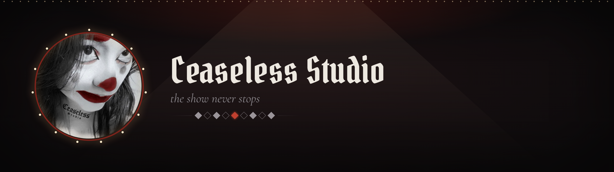

<!--
  Ceaseless Studio - organization profile README
  1. Create a public repository named .github in the Ceaseless-Studio organization.
  2. Put this file in it as profile/README.md and the banner at profile/assets/banner.png.
  3. Keep only the badges for the stack actually in use.
-->

  

> **The clown:** *...So you found the backstage. Good. The show starts whether you're ready or not.*

  <a href="https://ceaseless-studio.github.io"><b>◆ Enter the stage → ceaseless-studio.github.io</b></a>

## About

- I build **Discord bots** and the quiet automation that keeps a server running while nobody's watching.
- I turn **visual novels into Russian** - translation and proofreading, currently *The Last Embrace* by NoX Productions.
- I run **the backstage of Discord communities**: roles, permissions, supporter tiers, the whole circus.
- Russian is native, English is my working one.

## Stack

## Projects

- **Ceaseless Bot** - the backstage of a modeling agency: contracts, reaction roles, supporter tiers and reports, so the runway show never stops. 
- **Maria** - Cease's personal assistant in the same house: greetings, `!gm` / `!gn` phrases, proof requests and publishing. 
- **Driven By Desire** - Discord backstage for the visual novel server, plus Russian localization work for the game. 
- **The Last Embrace** - Russian proofreading for the visual novel by NoX Productions. 

02 bots in production · 01 novel in proofreading · 04 acts on the bill

## Contact

◆ the grin stays on, the work never stops ◆

